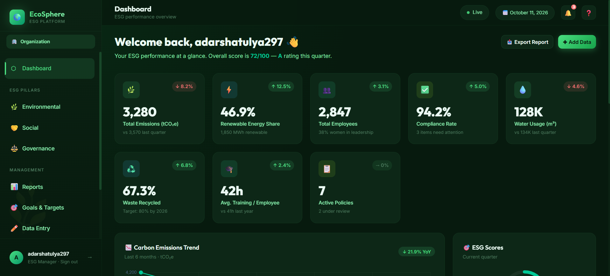

# 🌱 EcoSphere — ESG Management Platform



EcoSphere is an ESG (Environmental, Social, and Governance) Management Platform designed to help organizations monitor sustainability performance, track environmental impact, manage social responsibility activities, and improve governance through an interactive dashboard.

## 🌐 Live Demo

🔗 **Website:** https://eco-sphere-flax.vercel.app/auth

## ✨ Features

- 📊 **Interactive Dashboard** — View ESG performance and sustainability metrics.
- 🌍 **Environmental Tracking** — Monitor environmental impact and sustainability goals.
- 🤝 **Social Responsibility** — Manage CSR activities and employee participation.
- 🏛️ **Governance Management** — Track policies, compliance, and governance activities.
- 📈 **Data Visualization** — Present ESG data through charts and visual reports.
- 🎯 **Sustainability Goals** — Organize and monitor sustainability targets.
- 🔐 **Authentication** — User authentication through the configured authentication system.
- 📱 **Responsive Interface** — Access the platform across different screen sizes.

## 🛠️ Tech Stack

- **Frontend:** React, TypeScript, Vite
- **Styling:** CSS
- **Charts:** Recharts
- **Backend & Database:** Supabase, PostgreSQL
- **Deployment:** Vercel

## 🚀 Getting Started

### 1. Clone the Repository

```bash
git clone YOUR_REPOSITORY_URL
```

### 2. Navigate to the Project Directory

```bash
cd EcoSphere
```

### 3. Install Dependencies

```bash
npm install
```

### 4. Configure Environment Variables

Create a `.env` file in the project root and add the Supabase credentials required by your application.

```env
VITE_SUPABASE_URL=your_supabase_project_url
VITE_SUPABASE_ANON_KEY=your_supabase_publishable_or_anon_key
```

Use the exact variable names expected by your source code. Never expose your Supabase service-role key in frontend code.

### 5. Run the Development Server

```bash
npm run dev
```

Open the local URL displayed in your terminal to access the application.

## 🎯 Project Objective

The objective of EcoSphere is to provide a centralized platform for monitoring Environmental, Social, and Governance (ESG) performance. It aims to make sustainability tracking more organized, transparent, and accessible through a user-friendly interface.

## 🔮 Future Enhancements

- Automated ESG report generation
- Advanced carbon-emission analytics
- Sustainability challenges and gamification
- Notifications and reminders
- Detailed compliance reports
- Advanced performance analytics

## 👨‍💻 Author

**Adarsh Atulya**

- GitHub: https://github.com/aadarshatulya297-sudo

## 📄 License

This project is available for educational and development purposes. Add a specific open-source license if you intend to distribute it under one.
